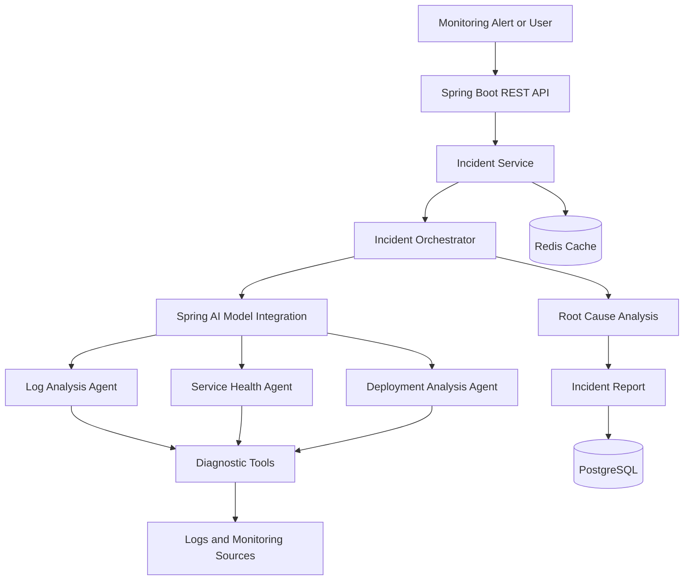

# Agentic AI Incident Analysis System

An AI-powered incident investigation platform built with **Java, Spring Boot, and Spring AI** that analyzes application failures, investigates potential root causes, and generates actionable remediation recommendations.

The system uses specialized AI agents and tool calling to investigate incidents using application logs, service health information, and recent deployment changes. Its goal is to reduce manual debugging effort and help developers and SRE teams resolve production incidents faster.

> **Project status:** In Development

## Table of Contents

- [Overview](#overview)
- [Key Features](#key-features)
- [System Architecture](#system-architecture)
- [Agent Workflow](#agent-workflow)
- [Technology Stack](#technology-stack)
- [Incident Analysis Example](#incident-analysis-example)
- [API Design](#api-design)
- [Database Design](#database-design)
- [Project Structure](#project-structure)
- [Getting Started](#getting-started)
- [Configuration](#configuration)
- [Security and Reliability](#security-and-reliability)
- [Future Enhancements](#future-enhancements)

## Overview

Diagnosing production incidents often requires developers to manually inspect logs, correlate errors across services, investigate recent deployments, and determine the underlying cause of failures.

This project aims to automate parts of that investigation through an agentic AI workflow.

When an incident is reported, the system gathers relevant evidence, invokes specialized investigation tools, evaluates potential causes, and produces a structured incident report.

Unlike a basic chatbot that only explains an error message, the system is designed to **investigate incidents by collecting evidence through tools and correlating multiple sources of information**.

### Project Goals

- Automate repetitive incident investigation tasks.
- Identify probable root causes from logs and operational evidence.
- Correlate application failures with service health and deployment changes.
- Generate structured, actionable incident reports.
- Maintain incident history for tracking and future analysis.
- Support safer, evidence-driven remediation decisions.

## Key Features

### 1. Automated Incident Ingestion

Accept incident reports through REST APIs, including application errors, service failures, exception details, and monitoring alerts.

Each incident can include:

- Incident title and description.
- Affected service or application.
- Severity and timestamp.
- Error messages and stack traces.
- Relevant log entries and diagnostic metadata.

The system records incidents for investigation and tracks their processing status.

### 2. Multi-Agent Incident Investigation

Use specialized AI agents to investigate different aspects of an incident.

**Incident Orchestrator Agent**

- Coordinates the investigation workflow.
- Determines which diagnostic tools are relevant.
- Delegates investigation tasks to specialized agents.
- Combines findings into a unified analysis.
- Tracks investigation progress and missing evidence.

**Log Analysis Agent**

- Examines application logs and stack traces.
- Identifies recurring exceptions and error patterns.
- Detects related errors across available log entries.
- Extracts evidence that supports potential root causes.

**Service Health Agent**

- Investigates available service health information.
- Examines metrics such as CPU usage, memory consumption, latency, and error rates when monitoring integrations are configured.
- Identifies abnormal service behavior around the incident time.
- Reports correlations between operational symptoms and failures.

**Deployment Analysis Agent**

- Examines recent deployment information when available.
- Correlates deployment timestamps with incident occurrence.
- Identifies changes that may have introduced regressions.
- Recommends further validation before attributing the incident to a release.

**Root Cause Analysis Agent**

- Evaluates findings from the investigation agents.
- Develops and ranks potential root cause hypotheses.
- Separates observed evidence from assumptions.
- Produces an explanation of the most likely failure mechanism.
- Identifies additional diagnostic checks needed to confirm the cause.

These agents have distinct responsibilities and share their findings through the orchestrator. The system should not treat an AI-generated hypothesis as a confirmed root cause without sufficient evidence.

### 3. Tool Calling and Evidence Collection

The agents can use controlled Java methods exposed as tools through Spring AI.

Potential diagnostic tools include:

| Tool | Purpose |
|---|---|
| `searchLogs()` | Retrieve logs matching an incident or time window. |
| `getServiceHealth()` | Retrieve available service health information. |
| `getServiceMetrics()` | Inspect latency, resource utilization, and error rates. |
| `getRecentDeployments()` | Retrieve recent deployment records. |
| `findSimilarIncidents()` | Search historical incidents for similar symptoms. |
| `getIncidentDetails()` | Retrieve incident metadata and investigation history. |

Tool availability depends on the integrations implemented in the application.

Tools return structured results that agents can interpret and use as evidence. Access to production systems should be read-only by default.

### 4. Root Cause Analysis

The system evaluates multiple possible explanations rather than relying on the first error message encountered.

For example, a database connection timeout could result from:

- Database unavailability.
- Connection pool exhaustion.
- Slow-running queries.
- Excessive concurrent requests.
- Network connectivity problems.
- A recent application change.

The investigation workflow compares these hypotheses against available evidence.

The resulting report can include:

- Probable root cause.
- Supporting evidence.
- Alternative hypotheses.
- Affected services.
- Recommended verification steps.
- Confidence assessment.
- Suggested remediation actions.

Confidence should be treated as an estimate of evidential support, not a statistically calibrated probability unless a separate calibration process is implemented.

### 5. Structured Incident Reports

Convert the investigation into a consistent, machine-readable report.

Example report structure:

```json
{
  "incidentId": "INC-1024",
  "severity": "HIGH",
  "status": "ANALYZED",
  "affectedService": "order-service",
  "probableRootCause": "Database connection pool exhaustion",
  "supportingEvidence": [
    "Repeated database connection acquisition timeouts",
    "Increased HTTP 500 responses"
  ],
  "alternativeHypotheses": [
    "Slow database queries",
    "Increased request concurrency"
  ],
  "recommendedActions": [
    "Inspect active database connections",
    "Identify long-running queries",
    "Review recent application changes"
  ]
}
```

This is an illustrative response format. The final schema should reflect the application's actual DTOs and implemented functionality.

### 6. Incident History and Retrieval

Store incident metadata and investigation results in PostgreSQL.

Historical incidents can help developers:

- Review previously investigated failures.
- Compare current incidents with earlier occurrences.
- Track incident status and resolution notes.
- Identify recurring application problems.
- Retrieve potentially relevant remediation guidance.

Redis can be used for caching frequently requested information, reducing repeated database reads, and optionally managing short-lived investigation state.

For semantic retrieval of similar incidents, PostgreSQL can be extended with pgvector and embeddings. This requires an additional vector-search implementation.

### 7. Remediation Recommendations

Generate actionable recommendations based on the evidence collected during investigation.

Examples include:

- Inspecting a database connection pool configuration.
- Investigating a slow SQL query.
- Reviewing a recent deployment.
- Checking service dependencies.
- Examining resource utilization.
- Adding missing logging or monitoring.

The system should distinguish between recommendations and actions actually executed.

Production-impacting actions such as restarting services, modifying configurations, or rolling back deployments should require explicit authorization and appropriate safeguards.

### 8. Incident Lifecycle Management

Track incidents through a lifecycle such as:

`OPEN → INVESTIGATING → ANALYZED → RESOLVED`

Additional statuses such as `FAILED` or `REQUIRES_HUMAN_REVIEW` can represent unsuccessful investigations or cases needing manual attention.

Persisting status transitions helps users understand investigation progress and review completed reports.

## System Architecture

The application follows a layered architecture that separates REST APIs, investigation orchestration, AI integration, diagnostic tools, and persistence.



### Architectural Responsibilities

- **Spring Boot:** REST endpoints, dependency injection, validation, application services, and exception handling.
- **Spring AI:** Model integration, tool calling, and agent orchestration components.
- **PostgreSQL:** Incident records, investigation results, and lifecycle history.
- **Redis:** Optional caching and short-lived state.
- **Diagnostic integrations:** Access to log stores, monitoring systems, and deployment records.

The diagram represents the intended architecture. Each component should be marked as implemented only after its corresponding integration is available.

## Agent Workflow

A typical incident investigation follows these steps:

1. **Incident creation:** A user or monitoring system submits an incident.
2. **Validation:** The application validates the payload and stores the incident.
3. **Investigation planning:** The orchestrator determines which evidence is required.
4. **Evidence collection:** Specialized agents invoke authorized diagnostic tools.
5. **Correlation:** The system correlates errors, metrics, and deployment events.
6. **Hypothesis evaluation:** The root cause agent compares possible explanations against the collected evidence.
7. **Report generation:** The system creates a structured report with supporting evidence and recommendations.
8. **Persistence:** The incident report and status are saved in PostgreSQL.
9. **Review:** A developer reviews the findings and performs or approves remediation.

The workflow should support bounded retries, tool timeouts, and a maximum number of investigation steps to prevent runaway model or tool execution.

## Technology Stack

| Technology | Role |
|---|---|
| Java 21 | Application development |
| Spring Boot | Backend framework and REST APIs |
| Spring AI | LLM integration and tool calling |
| OpenAI API | Language model provider |
| PostgreSQL | Persistent incident storage |
| Redis | Caching and optional temporary state |
| Maven | Dependency and build management |
| Docker | Reproducible local development |

Optional integrations:

- Prometheus and Grafana for metrics.
- OpenSearch or Elasticsearch for log retrieval.
- OpenTelemetry for application traces and instrumentation.
- pgvector for semantic retrieval of historical incidents.
- Kafka for asynchronous incident ingestion and processing at higher volumes.

## Incident Analysis Example

Consider an order service that begins returning HTTP 500 errors.

### Observed Symptoms

- Increased request failures.
- Database connection acquisition timeouts.
- Elevated request latency.
- An increase in concurrent traffic.

### Investigation

The Log Analysis Agent identifies repeated database connection errors.

The Service Health Agent observes increased latency and connection pressure.

The Deployment Analysis Agent checks whether a recent release coincided with the incident.

The Root Cause Analysis Agent evaluates whether connection pool exhaustion, slow queries, or increased concurrency best explain the evidence.

### Expected Output

The system reports database connection pool exhaustion as a probable cause if the evidence supports that hypothesis.

It recommends checking active connections, query duration, connection leaks, and pool configuration before implementing a fix.

After a developer applies a change, the system can compare available metrics before and after remediation to help assess whether the incident has improved.

This example describes the intended behavior; actual findings depend on the available diagnostic data.

## API Design

The following endpoints are a proposed initial API contract.

| Method | Endpoint | Purpose |
|---|---|---|
| `POST` | `/api/incidents` | Create a new incident. |
| `GET` | `/api/incidents` | List incidents with optional filters. |
| `GET` | `/api/incidents/{id}` | Retrieve incident details. |
| `POST` | `/api/incidents/{id}/analyze` | Start an investigation. |
| `GET` | `/api/incidents/{id}/report` | Retrieve the generated report. |
| `PATCH` | `/api/incidents/{id}/status` | Update the incident lifecycle status. |
| `GET` | `/api/incidents/{id}/history` | Retrieve incident history and status changes. |

The actual endpoints may differ depending on the implementation.

For asynchronous investigations, the analysis endpoint can return an accepted response and expose a separate status endpoint for progress tracking.

## Database Design

A possible initial relational model includes the following entities.

### Incident

Stores the core incident information.

- `id`
- `title`
- `description`
- `severity`
- `status`
- `affected_service`
- `created_at`
- `updated_at`

### Investigation

Stores investigation execution details.

- `id`
- `incident_id`
- `started_at`
- `completed_at`
- `status`
- `error_message`

### Investigation Finding

Stores diagnostic evidence and hypotheses.

- `id`
- `investigation_id`
- `source_type`
- `finding_type`
- `description`
- `evidence_reference`
- `created_at`

### Incident Report

Stores the final analysis and recommendations.

- `id`
- `incident_id`
- `probable_root_cause`
- `confidence_score`
- `supporting_evidence`
- `alternative_hypotheses`
- `recommended_actions`
- `created_at`

The final schema should use appropriate foreign keys, indexes, validation constraints, and retention policies. Large log payloads are generally better kept in a log platform or object store, with references stored in PostgreSQL.

## Project Structure

An example Spring Boot package structure:

```text
src/main/java/com/example/incidentai/
├── IncidentAiApplication.java
├── controller/
│   └── IncidentController.java
├── service/
│   ├── IncidentService.java
│   └── InvestigationService.java
├── agent/
│   ├── IncidentOrchestrator.java
│   ├── LogAnalysisAgent.java
│   ├── ServiceHealthAgent.java
│   ├── DeploymentAnalysisAgent.java
│   └── RootCauseAnalysisAgent.java
├── tools/
│   ├── LogSearchTools.java
│   ├── ServiceHealthTools.java
│   └── DeploymentTools.java
├── entity/
│   ├── Incident.java
│   ├── Investigation.java
│   └── IncidentReport.java
├── repository/
│   ├── IncidentRepository.java
│   └── IncidentReportRepository.java
├── dto/
│   ├── CreateIncidentRequest.java
│   └── IncidentAnalysisResponse.java
├── config/
│   └── AiConfiguration.java
└── exception/
    └── GlobalExceptionHandler.java
```

This structure is a suggested starting point, not a claim about existing source files.

## Getting Started

### Prerequisites

- JDK 21 or a compatible version supported by your chosen Spring Boot release.
- Maven.
- PostgreSQL.
- Redis if caching is enabled.
- An API key for the configured language model provider.

### 1. Clone the repository

```bash
git clone <your-repository-url>
cd incident-ai
```

Replace the repository URL and directory name with your actual values.

### 2. Configure environment variables

Configure database credentials and your model provider's API key through environment variables.

For example:

```bash
export DB_URL=jdbc:postgresql://localhost:5432/incident_ai
export DB_USERNAME=postgres
export DB_PASSWORD=your_local_password
export OPENAI_API_KEY=your_api_key
```

Use placeholder values in documentation. Never commit actual API keys or production credentials.

### 3. Configure Spring Boot

An illustrative `application.yml`:

```yaml
spring:
  datasource:
    url: ${DB_URL}
    username: ${DB_USERNAME}
    password: ${DB_PASSWORD}

  jpa:
    hibernate:
      ddl-auto: validate

  ai:
    openai:
      api-key: ${OPENAI_API_KEY}
```

The exact Spring AI properties and dependencies depend on the Spring AI version and model provider selected. Add the corresponding JDBC, JPA, Redis, and Spring AI starters to your Maven configuration.

Use migrations such as Flyway or Liquibase to create and update the database schema.

### 4. Start the application

```bash
./mvnw spring-boot:run
```

On Windows:

```bash
mvnw.cmd spring-boot:run
```

### 5. Submit a test incident

Once the incident API is implemented, a sample request might look like this:

```bash
curl -X POST http://localhost:8080/api/incidents \
  -H "Content-Type: application/json" \
  -d '{
    "title": "Order service database timeout",
    "description": "Requests are failing with database connection timeouts",
    "severity": "HIGH",
    "affectedService": "order-service"
  }'
```

Use the actual request fields and endpoint contract defined by your implementation.

## Security and Reliability

Production incident data can contain sensitive information, so security must be part of the design.

- **Secret management:** Keep API keys and database credentials outside source control.
- **Access control:** Authenticate users and authorize access to incident data and administrative operations.
- **Log sanitization:** Remove credentials, tokens, and unnecessary personal information before sending evidence to an external model.
- **Read-only investigation:** Restrict diagnostic tools to explicitly authorized operations.
- **Human approval:** Require authorization before production-impacting remediation.
- **Timeouts and retries:** Bound model calls and external tool execution.
- **Idempotency:** Prevent duplicate incident creation or repeated processing where appropriate.
- **Auditability:** Record investigation steps, tool results, report versions, and approved actions.
- **Prompt-injection defense:** Treat log messages and external diagnostic content as untrusted data, not instructions.
- **Failure handling:** Preserve the incident record if model calls or integrations fail.

## Testing Strategy

The project should include:

- Unit tests for incident services and root cause evaluation logic.
- Integration tests for PostgreSQL persistence and REST APIs.
- Tests for tool-call argument validation and authorization.
- Tests for model failures, timeouts, retries, and malformed responses.
- Evaluation scenarios with known incident causes and expected evidence.
- End-to-end tests using simulated logs, service failures, and deployment events.

Evaluate the system using root cause identification accuracy, evidence relevance, investigation duration, recommendation usefulness, and the rate of unsupported conclusions.

## Future Enhancements

- **Real-time monitoring integration:** Automatically ingest alerts from monitoring platforms.
- **Semantic incident search:** Use embeddings and pgvector to retrieve incidents with similar symptoms.
- **Distributed tracing:** Correlate failures across microservices using trace identifiers.
- **Deployment intelligence:** Integrate CI/CD metadata to investigate release-related regressions.
- **Automated recovery validation:** Compare health metrics before and after a remediation.
- **Approval-based remediation:** Integrate controlled operational actions with audit trails and rollback plans.
- **Incident dashboard:** Visualize investigation status, affected services, evidence, and recommendations.
- **Asynchronous processing:** Use Kafka to handle high incident volumes and decouple ingestion from investigation.
- **Continuous evaluation:** Build a benchmark of historical incidents to measure improvements in root cause accuracy.

## Expected Outcome

The Agentic AI Incident Analysis System is designed to demonstrate how Spring Boot and agentic AI can work together to automate production incident investigation.

It combines backend engineering, LLM tool calling, evidence collection, incident persistence, root cause reasoning, and operational safety into a practical software engineering project.

The long-term objective is to help engineering teams move from manually investigating scattered operational signals toward faster, more consistent, and evidence-driven incident resolution.
